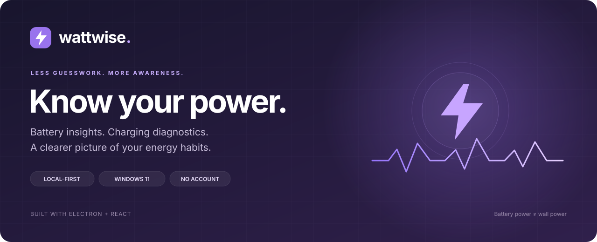
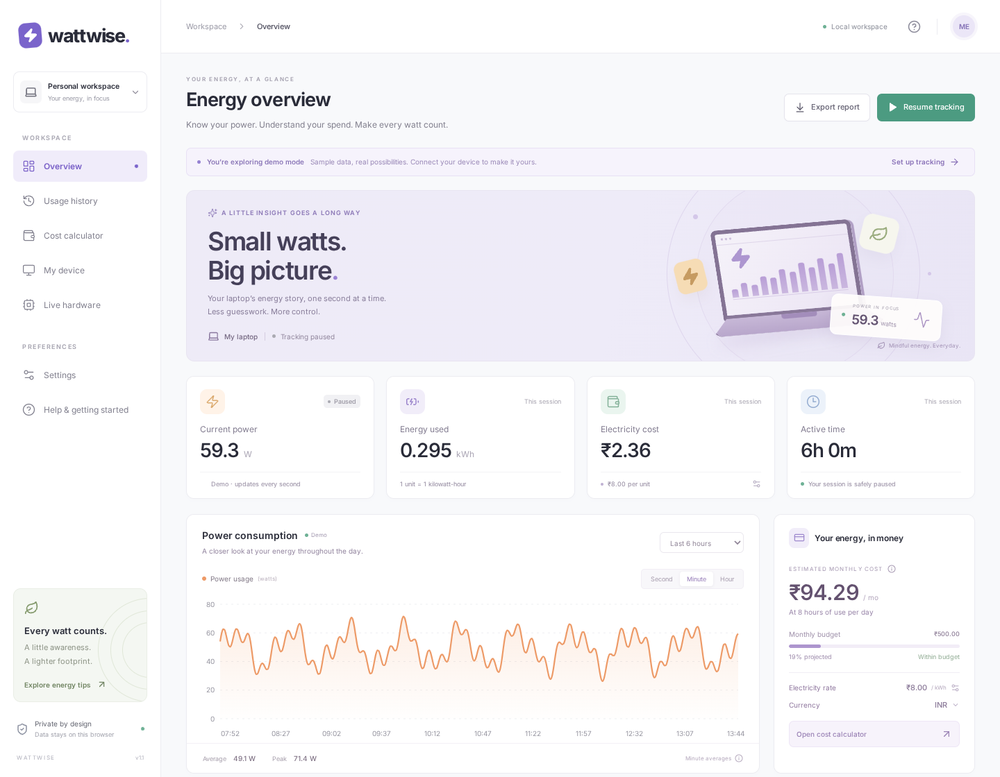
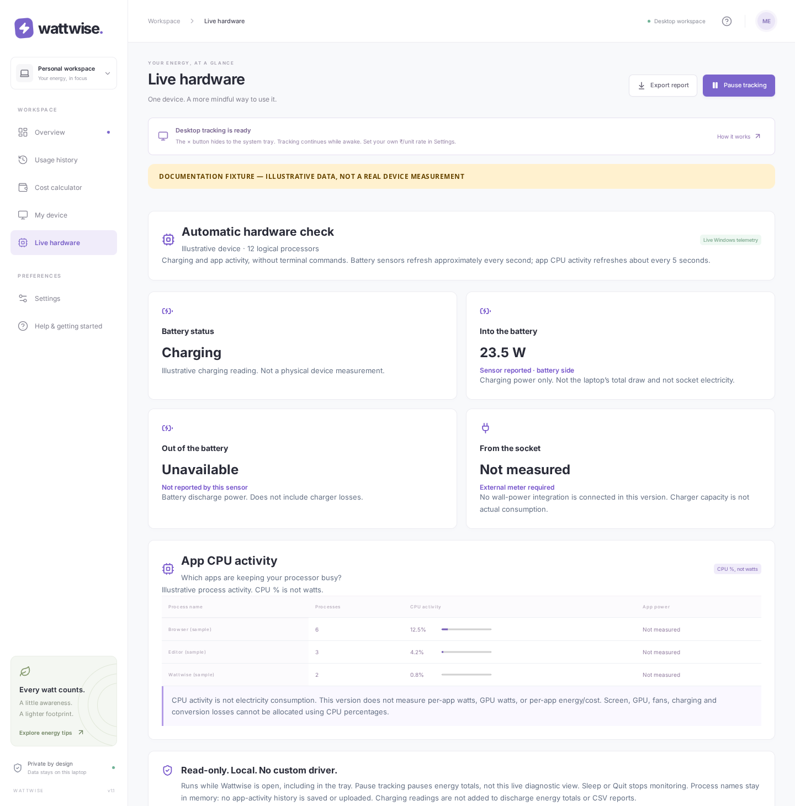

<p align="center">
  
</p>

<p align="center">
  <strong>A local-first energy companion for your Windows laptop.</strong><br />
  Understand battery power, check charging sensors, explore app CPU activity,<br />
  and turn recorded energy or wattage estimates into useful cost insights.
</p>

<p align="center">
  <a href="https://github.com/nikhilnikhil4331/Wattwise/actions/workflows/windows-desktop.yml"></a>
  <a href="https://github.com/nikhilnikhil4331/Wattwise/releases"></a>
  
  
</p>

<p align="center">
  <a href="https://github.com/nikhilnikhil4331/Wattwise/releases"><strong>Download for Windows</strong></a> ·
  <a href="#quick-start">Quick start</a> ·
  <a href="#what-wattwise-can--cannot-measure">Accuracy</a> ·
  <a href="docs/WINDOWS-DESKTOP.md">Documentation</a> ·
  <a href="https://github.com/nikhilnikhil4331/Wattwise/issues/new/choose">Report an issue</a>
</p>

---

## Your energy, at a glance

<p align="center">
  
  <br /><sub>Actual app UI in <strong>Demo preview</strong>. The numbers are sample data, not measurements from a laptop.</sub>
</p>

<table>
  <tr>
    <td width="50%"><h3>⚡ Battery insights</h3><p>Supported Windows battery discharge readings, second/minute/hour views, kWh totals and tariff-based cost equivalents.</p></td>
    <td width="50%"><h3>🔌 Charging diagnostics</h3><p>Automatically check charging state and sensor-reported charging watts. Unsupported hardware stays clearly labeled unavailable.</p></td>
  </tr>
  <tr>
    <td><h3>🧠 Live app activity</h3><p>See the top process-name groups by CPU activity. CPU percentages are normalized across logical processors—not presented as watts.</p></td>
    <td><h3>💸 Costs that make sense</h3><p>Set your currency and per-kWh tariff. Explore wattage estimates, monthly projections and budgets without treating them as your actual bill.</p></td>
  </tr>
  <tr>
    <td><h3>🖥️ Built for the desktop</h3><p>Close to the tray, keep tracking while awake, and optionally start with Windows. Installed builds need no Node.js or Python.</p></td>
    <td><h3>🔒 Local by design</h3><p>No account or cloud sync. Energy history saves locally, CSV exports stay yours, and app-activity names are kept only in memory.</p></td>
  </tr>
</table>

<details>
<summary><strong>See the Live hardware view</strong></summary>



This is the actual UI rendered with a **documentation fixture**, not readings from a physical laptop. The fixture is explicitly labeled inside the image. Real sensor availability varies by device.

</details>

## Quick start

### Install on Windows

1. Open **[Releases](https://github.com/nikhilnikhil4331/Wattwise/releases)** and choose the newest Windows preview. Download its `Wattwise-Setup-<version>-x64.exe` and optional `.sha256` file.
2. If upgrading, **Quit Wattwise from its tray icon** first. Run the installer and launch Wattwise.
3. Open **Settings**, choose your currency, and enter the electricity rate from your bill. The default ₹8/unit is only an example.
4. With the charger connected, open **Live hardware** and wait about 5–15 seconds. Charging watts appear only if the battery driver provides a valid rate.
5. For battery-energy history, choose **Battery sensor** while discharging. For an approximation while plugged in, explicitly choose **Wattage estimate**.

> [!IMPORTANT]
> This is an **unsigned early preview** for Windows 11 x64. SmartScreen or organization policy may warn or block installation. Verify the release origin and checksum; do not disable Windows security or bypass your organization's policy. ARM64 is not separately packaged.

<details>
<summary><strong>Verify the installer checksum</strong></summary>

In PowerShell, replace the filename with the one you downloaded:

```powershell
Get-FileHash .\Wattwise-Setup-1.1.0-x64.exe -Algorithm SHA256
```

Compare the complete hash with the matching `.exe.sha256` release asset. A match checks file integrity against that checksum; it is not a publisher signature.

</details>

### Pick the right view

| Your question                              | Use                                    | What it means                                                     |
| :----------------------------------------- | :------------------------------------- | :---------------------------------------------------------------- |
| How much energy has my battery delivered?  | **Battery sensor**                     | Supported discharge power integrated over recorded time.          |
| Is the battery charging, and at what rate? | **Live hardware**                      | Battery-side charging telemetry, if exposed by Windows.           |
| Which apps are keeping the CPU busy?       | **Live hardware → App CPU activity**   | CPU-time deltas grouped by process name; not per-app electricity. |
| What might this usage cost?                | **Wattage estimate / Cost calculator** | A calculation from your watts, duration and tariff.               |
| Can I explore without a sensor?            | **Demo preview**                       | Clearly labeled sample data.                                      |

## What Wattwise can & cannot measure

**Honest readings matter more than impressive numbers.**

| Capability                                   | Status                                                                                    |
| :------------------------------------------- | :---------------------------------------------------------------------------------------- |
| Battery discharge power                      | Sensor-reported, when supported and discharging.                                          |
| Battery charging power                       | Sensor-reported, when the driver exposes a valid charge rate.                             |
| App CPU activity                             | Available for readable processes; protected, new or exited processes may be omitted.      |
| Socket / wall-input watts and kWh            | **Not measured.** An external energy meter is needed; direct integration is not included. |
| Per-app watts, kWh or electricity cost       | **Not measured.** CPU % is not a power measurement.                                       |
| CPU/GPU package power                        | **Not implemented.** Hardware telemetry support varies.                                   |
| Sleep, shutdown and missing sensor intervals | **Not backfilled.** No invented readings or silent estimate fallback.                     |

Battery charging power excludes the laptop's other loads and charger losses. Battery-energy cost is a **tariff-based equivalent**, not the electricity cost of charging it. A 65 W charger rating is a capacity, not a live consumption reading.

Charging diagnostics are separate from discharge-history totals and CSV exports. Pausing energy tracking does not stop the live diagnostic view; **Sleep or Quit** stops monitoring.

## Run from source

Requires **Node.js 22.12+** and npm. The optional Python agent is separate from the built-in Windows desktop reader.

```bash
git clone https://github.com/nikhilnikhil4331/Wattwise.git
cd Wattwise
npm ci
npm run dev
```

The browser version starts in labeled demo mode. It cannot inspect running Windows processes or provide the desktop charging diagnostics. Browser sensor mode requires the [local agent](docs/WATTWISE.md).

```bash
# Windows desktop app
npm run desktop

# Windows x64 NSIS installer
npm run package:win
```

Prefer a double-click launcher? See **[Windows start guide](WINDOWS-START-HERE.txt)**. Packaged output goes to `build/windows/` and is not committed to Git.

## Under the hood

```text
React + Recharts UI
        │  restricted IPC bridge
Electron main process
        ├── Energy tracker → local state.json → CSV export
        └── Read-only Windows PowerShell reader
                ├── WMI battery charging / discharge telemetry
                └── Process CPU-time counters → in-memory activity view
```

**React 19 · Vite 6 · Electron · Recharts · NSIS · Node.js tests · Playwright**

The renderer uses context isolation, sandboxing and a narrow preload bridge. There is no custom kernel driver, privilege elevation, arbitrary renderer shell API, or security-policy bypass. See [desktop architecture and storage](docs/WINDOWS-DESKTOP.md).

<details>
<summary><strong>Repository map</strong></summary>

```text
src/          React UI, energy calculations and browser persistence
desktop/      Electron app, tracker, storage and Windows telemetry
agent/        Optional Python battery agent for browser mode
scripts/      Windows source launcher and packaged-app smoke test
tests/        Unit, browser, desktop and agent tests
docs/         Guides, release notes and repository assets
.github/      Build workflows, issue forms and contributor templates
```

</details>

## Development & quality

```bash
npm test                          # JavaScript unit tests
npx playwright install chromium   # One-time browser setup
npm run test:e2e                   # Browser UI and desktop-bridge fixtures
python -m unittest discover -s tests -p "test_*.py"
npm run build                     # Production UI
node .github/scripts/check-docs.mjs
```

The [Windows workflow](.github/workflows/windows-desktop.yml) installs locked dependencies, runs unit/browser tests, builds the installer, smoke-tests the **packaged app and actual Windows process feed**, then publishes a preview plus SHA-256 checksum. It currently publishes from `arena/2bd55f92-wattwise`; ordinary documentation changes do not trigger an installer build.

CI has no physical laptop battery. Real charging-sensor behavior, login startup, installation prompts and device-specific accuracy still require testing on hardware. See [Contributing](CONTRIBUTING.md) for validation expectations.

## Explore the project

| Resource                                         | What's inside                                                          |
| :----------------------------------------------- | :--------------------------------------------------------------------- |
| [Windows guide](docs/WINDOWS-DESKTOP.md)         | Installation, background behavior, telemetry, storage and limitations. |
| [Calculations & browser guide](docs/WATTWISE.md) | Units, tariffs, sampling, retention and the optional agent.            |
| [Changelog](CHANGELOG.md)                        | What changed in each preview.                                          |
| [Roadmap](docs/ROADMAP.md)                       | Current capabilities and ideas—not promised integrations.              |
| [Contributing](CONTRIBUTING.md)                  | Development workflow, tests and review checklist.                      |
| [Security](SECURITY.md)                          | Safe reporting and security boundaries.                                |
| [Support](SUPPORT.md)                            | What to try and what information to include in a report.               |

## Community & project status

Feedback, reproducible bug reports and thoughtful contributions are welcome. Start with the [issue forms](https://github.com/nikhilnikhil4331/Wattwise/issues/new/choose), read the [contribution guide](CONTRIBUTING.md), and follow our [Code of Conduct](CODE_OF_CONDUCT.md).

**Licensing:** no project license has been selected yet. A public repository is not, by itself, a general permission to reuse or redistribute the source. See [the maintainer setup checklist](docs/REPOSITORY-SETUP.md) for the pending license decision. Third-party dependencies keep their respective licenses.

<details>
<summary><strong>Project origin</strong></summary>

Wattwise was imported from [NKL PR #1](https://github.com/nikhilnikhil4331/NKL/pull/1), commit [`c754004`](https://github.com/nikhilnikhil4331/NKL/commit/c754004d53353d4831187abd85151d61c55e10c9). The standalone project, including the 1.1 live hardware view, is maintained in this repository.

</details>

---

<p align="center"><strong>Small watts. A clearer picture.</strong><br /><sub>Built for awareness—not a certified energy meter.</sub></p>
